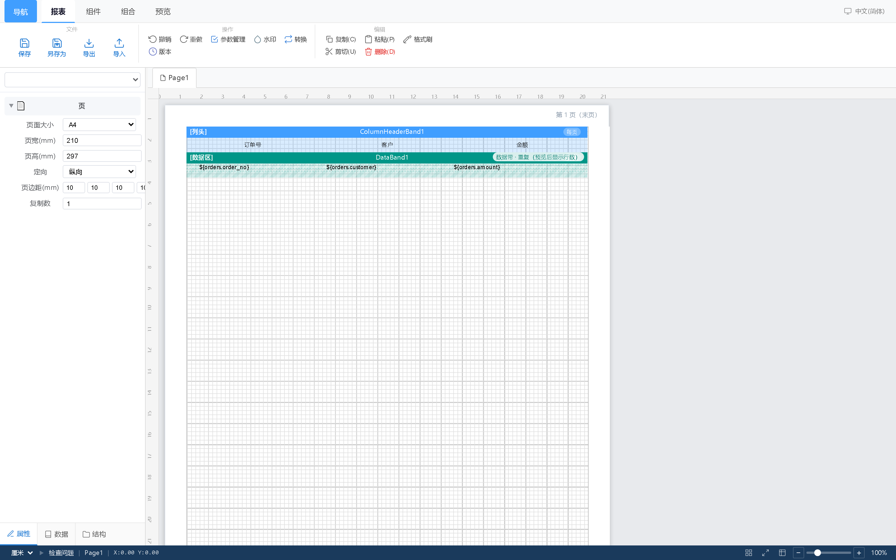

# 教程 1：10 分钟做出第一张报表（Windows，纯 CSV，不用装数据库）

> 适用：刚下载完、机器上没有任何数据库的第一次试用。
> 目标：用一份 CSV 文件当数据源，做一张带表头、数据区和页脚合计的销售明细报表，并导出 PDF。



## 准备

- Windows 10/11 x64；
- `GimbalX-Report-1.0.0-win64.zip`（79.4 MB）；
- 一份 CSV，比如 `sales.csv`（UTF-8，首行是列名）：

```csv
order_no,customer,region,amount,order_date
A-1001,杭州甲公司,华东,1280.50,2026-01-05
A-1002,苏州乙公司,华东,2560.00,2026-01-06
A-1003,成都丙公司,西南,980.00,2026-01-08
A-1004,广州丁公司,华南,3120.75,2026-01-11
A-1005,西安戊公司,西北,760.00,2026-01-15
```

## 步骤

### 1. 启动

1. 解压 zip 到任意可写目录，例如 `D:\GimbalX`（**不要**放 `C:\Program Files`）；
2. 双击 `start.bat`，看到「正在执行数据库迁移...」后出现启动成功的地址；
3. 浏览器打开 <http://127.0.0.1:8090>；
4. 首次进入初始化向导：填管理员账号（≥3 位）、密码（≥8 位）→ 授权这步可以直接跳过（试用）→ 完成。

### 2. 新建报表

「报表」页签 → **新建**（或首页的「新建报表」）→ 命名，例如 `销售明细-教程`。

### 3. 加 CSV 数据源

1. 左侧**字典面板** → 新建连接 → 数据源类型选 **CSV 文件**；
2. 上传刚准备的 `sales.csv`（或填文件路径）；
3. 保存后，面板里会出现一个表节点，展开能看到 `order_no`、`customer`、`region`、`amount`、`order_date` 五个字段；
4. 把预览行数限制在 100 行左右（够看效果即可）。

> 字典面板里的查询相当于「数据集」：给它起个好记的名字（如 `orders`），后面拖字段和写表达式都用这个名字。

### 4. 搭骨架

切到「组件」页签，依次把下面几个带区拖进画布（顺序会自动排列）：

| 拖入的带区 | 放什么 |
|---|---|
| **列头** | 五个文本元素：订单号 / 客户 / 区域 / 金额 / 日期 |
| **数据区** | 五个文本元素，分别绑定 `orders.order_no`、`orders.customer`、`orders.region`、`orders.amount`、`orders.order_date` |
| **页脚** | 两个文本元素：`合计：` 和 `SUM(orders.amount)` |

绑定字段的方法：选中文本元素 → 右侧属性面板 → 文本内容里选字段（或直接手写表达式 `{orders.customer}` 这类写法，以界面提示为准）。

### 5. 调样式

- 选中列头的五个文本 → 「组合」页签 → **同高**、**上对齐**，让表头整齐；
- 数据区的金额列：属性面板 → 数字格式选两位小数、右对齐；
- 整行边框：选中元素 → 属性面板 → 边框，先给列头和数据区加下划线即可。

### 6. 预览与导出

1. 切「**预览**」页签，看分页效果（1 页以内无水印）；
2. 右上角格式下拉选 **PDF** → 点导出 → 下载；
3. 打开 PDF，检查：表头只出现一次、数据 5 行、页脚合计 `8709.25`。

## 常见问题

**双击 start.bat 一闪而过 / 报错找不到命令**
解压不完整或路径含特殊字符。重新解压到 `D:\GimbalX` 这类短路径再试；仍失败就用命令行 `cd` 到目录执行 `start.bat`，把报错贴出来。

**CSV 里的中文变成乱码**
把 CSV 另存为 **UTF-8（带或不带 BOM 均可）**，不要用 GBK。

**数据区只显示一行**
说明数据区没有和数据集绑定上。检查元素绑定的字段名前缀是否与字典面板里的查询名一致。

**预览是空白**
点一次「刷新/重新取数」，或确认 CSV 已被读取（字典面板里能看到行数）。

## 验收标准

- [ ] 浏览器能打开 `127.0.0.1:8090` 并登录；
- [ ] 预览里看到 5 行数据，金额右对齐、两位小数；
- [ ] 页脚合计等于 8709.25；
- [ ] 导出的 PDF 能正常打开，文字不是方框（中文正常）。

做到这四条，说明环境和基本流程都通了，可以进 [教程 2](02-mysql-grouped-report.md) 连真库做分组报表。